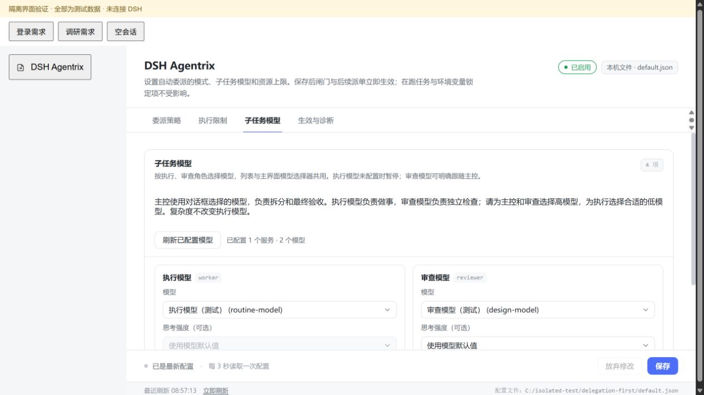
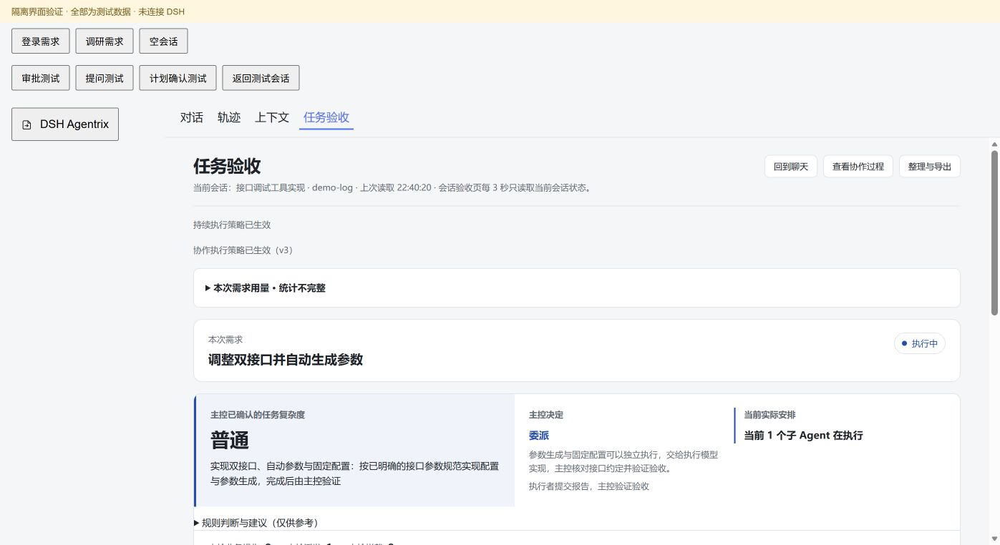

# DSH Agentrix

多 Agent 编排与验收。

让主 Agent 负责拆分任务、监督和验收，让子 Agent 按配置的模型执行。

插件使用 DSH 原生子代理，提供任务计划、进度展示、并发与启动次数限制、结构化报告和基于实际证据的验收。主控说“完成了”不会直接把任务标为已完成，最终状态由插件保存的验收回执决定。

当前源码将自动分流交给主控判断：小任务直接完成，需要较多执行工作时委派；执行复杂度与审查方式分开记录，主控按错误风险选择审查。模型调用达到 80 次及运行时间达到配置值时仅提醒，不终止、不更换代理。已有模型、并发、返工与启动次数设置继续保留。

## 模型怎么分工

| 角色 | 模型来源 | 工作 |
| --- | --- | --- |
| 主控 | 当前对话框选择的模型 | 理解需求、拆分、监督、执行验证并最终验收 |
| 执行者 | 插件配置的 worker | 按任务卡完成具体工作 |
| 独立审查者 | 自动沿用该次任务分发时的主控模型与思考强度 | 独立上下文，只读检查需求和交付质量 |

选择高模型做主控、合适的低模型做执行者，独立审查自动沿用分发者的高模型。执行模型列表直接读取 DSH 已配置的服务，无需重复填写 API Key、Provider 或模型标识。

新任务可填写 `reviewPolicy: coordinator/independent` 和非空 `reviewReason`，分别表示主控验证验收或额外独立审查。权限、破坏性数据操作、并发等高风险工作应选择独立审查；调查量大不直接意味着需要增加审查代理。未填写这两个字段时沿用旧约定：复杂任务自动审查，普通任务由主控验证，也可请求审查。复杂度不会自动切换执行模型。执行模型未配置时暂停派发；每个任务启动后固定模型快照，后续修改配置只影响新任务。

## 安装

安装包继续使用原有标识 `@local/dsh-delegation-first`，已有安装、配置和历史记录可继续使用。

需要支持原生子代理的 DeepSeek Harness。当前验证范围为 Windows、PowerShell 7（`pwsh`）和 Git；其他系统尚未验证。

桌面版使用应用内的插件管理或插件市场安装。未收录时，可使用[本仓库地址](https://github.com/991206772-debug/dsh-agentrix)或 [Releases 安装包](https://github.com/991206772-debug/dsh-agentrix/releases/latest/download/dsh-agentrix.tgz)作为安装来源。

命令行版在自己的 Profile 中安装，命令格式为：

```powershell
dsh plugin --profile <Profile名称> add <GitHub仓库地址或tgz文件路径>
```

`--profile` 位于 `plugin` 后面。独立安装的命令行版可能不允许管理桌面版保留的 `desktop` Profile，桌面版应使用应用自身的安装入口。

安装后在插件管理中启用“DSH Agentrix”。配置和任务详情还需要 DSH 的 Web 界面服务。

## 第一次使用

1. 在对话框选择负责规划与验收的主控模型。
2. 打开侧栏“DSH Agentrix”，只需选择执行模型。独立审查自动沿用各次任务分发时记录的主控模型与思考强度。
3. 保存配置，再向主控提出任务。可先在临时项目中执行一个小任务，检查执行、报告、实际验证和验收回执。

侧栏负责配置；输入框上方的紧凑信息条直接显示执行状态。主控处理时并排显示当前动作、实际模型和本轮工具次数；托管计划显示子任务状态、等待数量和验收进度。点击信息条向上打开详情，输入框位置保持稳定。主控详情按“当前执行、执行判断、本次需求”分区，判断理由与完整需求保留全文；发生异常时单独列出记录。面板随聊天区域宽度调整，窄区域自动改为上下排布。再次点击信息条、点外部或按 Esc 收起详情。主控直接执行时也显示进度；系统建议委派但实际直接执行时，会在详情中明确区分。委派工具缺失或插件接口不可用时显示提醒。当前会话的“任务验收”页显示需求、任务、所用模型、验证证据和未完成原因；聊天消息旁的进度按钮也可进入该页。这里展示的模型是 DSH 发给服务商的标识；服务商路由组内部的选型以服务商信息为准。

多 Agent 详情按任务使用手风琴展示：收起时可见任务名、状态和当前角色的模型；展开后查看同一任务的执行者、独立审查、当前活动、报告摘要、异常和验收情况。状态条分别显示总任务数、执行数和等待数；有依赖的任务标为“等待前置任务”。默认展开第一项，也可同时展开多项；自动刷新或阶段变化保留当前展开选择。主控判断折叠放在任务清单后方。

“任务验收”页采用只读的“专注群聊”看板，仅展示当前会话、当前需求。可按主控、执行者和独立审查者筛选近期工具活动、阶段记录及正式报告；点击报告可展开任务与完整验收依据。默认显示最近 20 条，上方“查看更多”每次增加 20 条；各成员分别保留展开范围。消息会标明记录来源，不把工具事件伪装成 Agent 发言。看板整体共用一条纵向滚动条；任务详情默认收起，宽区域并排查看，窄区域切换到详情视图。补充需求仍在 DSH 原对话进行。

每项任务分别展示计划交付文件、执行报告和独立审查报告的位置。聊天中的任务手风琴可直接查看；验收页选择成员或展开任务后可复制完整路径，并区分计划交付、已提交报告和主控已验收。

更新插件后需由宿主重新加载才会生效。请先让已有任务收尾，再按宿主提示更新。

## 执行规则

| 设置 | 默认值 |
| --- | --- |
| 委派策略 | 自动；也可选择严格、固定预算或关闭 |
| 固定预算模式的主控业务操作额度 | 2（仅固定预算模式生效；自动模式不按此数值拦截） |
| 共享并发上限 | 4，支持 1–8 |
| 单任务最多执行次数 | 5，支持 1–10；包含首次执行 |
| 单计划启动尝试次数 | 64，支持 1–256；包含执行、返工和独立审查 |
| 运行时间提醒 | 120 分钟，支持 1–240；仅提醒，不停止 |

读取文件、固定目录/Git 检查和专用计划记录不占业务修改额度。存在待验收的托管计划时，主控通过专用验证入口检查交付物。

主控结合上下文判断消息属于新需求、继续、补充或进度询问，并通过 `delegation_decide` 记录。程序只登记真实消息，不按“还有”“继续”等关键词、字数或分数决定需求归属。新需求或方案变化时，同时记录直接执行或委派及具体理由；继续和进度询问沿用原决定。建计划可一并记录关联与委派理由，不增加分类代理；确认补充信息可能增加一次短工具往返。

状态标签详情与任务验收页显示主控确认的关联、理由和实际活动。多条消息待处理时须引用真实消息编号分别确认；新需求不会自动取消、改写旧任务。仍有旧计划运行时，新计划不能覆盖它；旧计划验收回执也不会把另一项新需求冒充为完成。遗漏关联时，每条待处理消息最多提醒原主控一次，重载不重置；用户取消后不唤醒。历史缺失显示“未记录”。

不再生成关键词难度评分、预计步数、并行数量或固定百分比置信度；历史快照保留。重复同类错误会通知主控处理；长时间没有新活动只作一次调查提醒，正常读取、模型输出和工具活动不会因没有写文件而被终止。最近 8 次活动中，同一操作和参数至少 3 次返回完全相同结果时，每次执行最多通知主控一次，核对这些操作是否仍有价值；这只是调查提醒，不停止、不换代理、不消耗故障纠偏次数。不同文件、片段、结果和修改后的重新测试分别处理；参数或输出不断变化的低价值操作仍需主控结合需求判断。80 次调用与运行时间提醒只显示在页面并记录事件，不唤醒主控、不消耗纠偏次数。输出被截断时在原代理续接，Token 不设插件上限；模型服务自身限制仍由 DSH 管理。主控验证沿用宿主取消信号，插件不再统一附加 60 秒截止时间。默认状态工具只返回摘要，完整报告按任务读取。

同类工作合批，只有独立产出、判断或并行价值才拆分；主控负责整合已有结果，不为转述报告默认另开代理。验收标准围绕用户要求和必要验证，不自行增加问题数量、篇幅或格式门槛。纯修复的派发和复审默认只提供原问题、相关标准、前次报告和本次修复报告；有新增用户要求时完整检查。最终验收仍覆盖全部原标准。完全相同的问题与证据只保留一个编号，不自动合并措辞相近但证据不同的问题。达标后交付，可选建议不继续触发返工。

单个任务失败只影响该任务及其依赖项，无关任务继续执行、排队和验收；模型错配仍会暂停后续派发。聊天详情保留运行任务的名称、当前动作和异常原因，计数使用“已验收”；单个失败不会替换整份进度。WorkBuddy 的明确通道拒绝显示为“本次请求被服务商拒绝”，不代表同模型的其他请求都不可用；处理限制后明确重试失败项，不自动换模型或重复启动。主控无原因调用整计划取消，不会取消或自动重开任务；整计划取消须提供原因并关联本会话新增真实用户消息。宿主中断会保留原计划，用户明确继续后先确认旧执行已释放，再继续未完成部分；已返回报告和已验收结果不重复执行。正常返回的子代理自动释放运行资源，历史子会话保留供回看。

`stop` 表示取消，必须说明原因。只有全部任务通过实际验收才生成完成回执；失败、阻塞和取消会列出未完成项。遗漏报告或验收时有次数有限的补流程提醒，用户取消后不会自动恢复。

验收完成后，插件先把结论和文件入口展示在聊天里，再结束回合。用户要求直接看文章或报告时，主控可在验收中指定交付文件，正文直接展开，无需再让模型生成一次总结。发送失败保留验收结果，继续同一会话只补发；新交付记录按原回复保存，不会混入后续需求。

模型生成的托管工具参数若不是合法 JSON，插件会在执行前把解析位置和附近片段反馈给原模型，原回合最多自动修正两次。次数持久化，查询状态或重载不会清零；不猜补参数、不换模型、不新开代理。语法修正成功后仍走原有权限、派发和验收检查，服务错误不按参数错误重试。

主控通过 `delegation_models` 查询托管执行和审查模型，查询与派发共用授权及解析检查，避免原生模型名单与实际托管配置互相矛盾。已记录的会话白名单仍会在启动前检查；没有白名单时使用用户保存的托管配置并标明来源。切换配置只影响后续启动，运行任务保留原模型快照；“检查通过”和“实际请求成功”分别记录。多条继续消息处理完才恢复原计划，旧 direct 判断可在 continue 中给出委派理由修正，不必重建任务卡。

主控直接执行时，文件修改工具失败会留下未完成记录。成功读取文件或生成另一份文件不会清除该记录；原主控结束前最多收到一次补救提醒，成功修改同一目标后清除。仍未修复时保留“修改未完成”提示，不无限续跑。直接执行的进度不属于托管验收回执，也不能证明内容已满足全部要求。

## 数据和边界

配置与任务记录保存在当前 DSH Home 的 `delegation-first/` 目录，按 Profile 区分。记录包含真实消息、需求关联、任务说明、报告、验证证据和模型标识；公开问题报告前请检查其中的项目内容。判定前的主控用量暂存，确认关联后归入对应需求，重载后保留。插件没有独立的云同步或模型服务，子代理请求通过 DSH 已配置的服务发送。

任务修改范围用于调度与冲突检查，不是文件系统沙箱。执行模型的能力和价格由用户选择；插件不根据名称猜测能力，也不静默替换不可用模型。配置检查不发送生成请求，不能预先判断服务商额度或网络状态。

详细工具、状态、报告、验收与 HTTP 接口见 [使用约定](docs/usage.md)。

## 开发和验证

使用 Node.js 22.3 或更高版本。安装版契约当前核对的宿主版本为 DSH Desktop 0.2.2-rc.1，尚未验证其他版本：

```powershell
npm test
npm run check
npm pack --dry-run
```

单元测试包含打包文件范围检查。两份安装版契约脚本需要本机 DSH，并使用其 Electron 的 Node 模式和 `DSH_MODULE_ROOT`：

- `tests/native-contract.mjs`：真实 Cordis、ToolRuntime 和 LlmRuntime，子代理使用替身。
- `tests/native-lifecycle.mjs`：真实 AgentLoop、ToolRuntime 和 SubagentRuntime，外部模型使用脚本化适配器。

这些测试与真实服务商模型会话分别验证，不能相互替代。`tests/ui-preview.mjs` 使用隔离演示数据展示页面，不连接真实 DSH 或写入用户配置。

安装包只包含运行文件、说明、技能和展示素材；测试与本机开发记录不进入安装包。

## 界面演示

以下为隔离测试数据，不代表真实会话或真实模型服务结果。





## 许可证

[MIT](LICENSE)，署名 991206772-debug。
